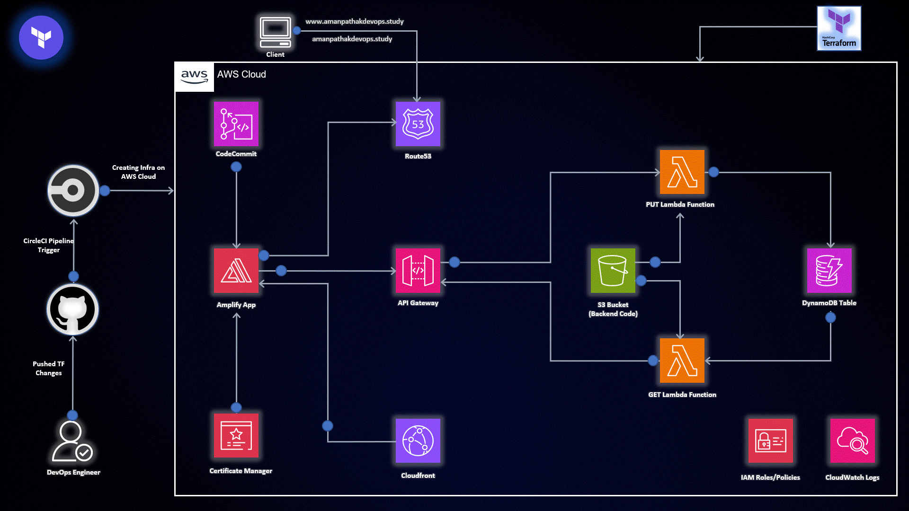

# AWS serverless student registry

Portfolio lab maintained in [bckish/aws-serverless-terraform](https://github.com/bckish/aws-serverless-terraform). The implementation is derived from upstream work; this repository's documentation and validation changes do not imply an independently verified cloud deployment.

A learning lab for an HTML/CSS/JavaScript student registry backed by Python Lambda handlers, API Gateway and DynamoDB. The source contains application code and an IAM policy example; Terraform configuration is linked upstream, not included in this checkout.



## Repository map

- [Frontend](Frontend/): static web UI and service worker.
- [Backend](Backend/): GET and POST Lambda handlers.
- [DynamoDB-Policy](DynamoDB-Policy/): sample policy; review scope before use.

## Local validation

Run a fully local browser demo with an in-memory table (no AWS credentials or dependencies):

```bash
python3 local_server.py
# Open http://127.0.0.1:8080
python3 -m unittest discover -s tests
```

The demo shares the Lambda handler's data logic, but does not exercise live DynamoDB or API Gateway. The cloud handlers use the SDK's region configuration and optional STUDENT_TABLE environment variable.

```bash
git clone https://github.com/bckish/aws-serverless-terraform.git
cd aws-serverless-terraform
python3 -m compileall -q Backend
node --check Frontend/js/app.js
```

Before using the browser application, set `API_BASE_URL` in [Frontend/js/app.js](Frontend/js/app.js) to your own API Gateway stage URL (without the `/getStudent` or `/addStudent` suffix); never submit student data to an inherited endpoint. The handlers expect a DynamoDB table named Student-Details and the GET handler specifies a region; configure both for your own environment. Use synthetic data only.

For infrastructure, consult the original [Terraform example](https://github.com/AmanPathak-DevOps/Terraform-for-AWS/blob/master/Non-Modularized/AWS-Serverless-Project/) separately. Review IAM, authentication, CORS, state and cost before any AWS deployment. This checkout has no self-contained Terraform root; no cloud deployment has been verified.

## Attribution and license

Original implementation by Aman Pathak. See [UPSTREAM.md](UPSTREAM.md) for the source repository and [LICENSE](LICENSE) (MIT). The upstream license and copyright notices are unchanged.

## Verified local Kubernetes results

Test date: 25 November 2026. Environment: Docker Desktop on Apple Silicon, Kind v0.30.0, Kubernetes v1.34.3. Local images were imported into the isolated cluster; no images were pushed to a registry and no paid cloud resources were created.

Tested code: `721f649` (merged main). Built the [local emulator Docker image](Dockerfile.local), loaded its ARM64 image into Kind, and deployed it with the included [local manifest](local-k8s/app.yaml). The pod was Ready, its frontend returned HTTP 200, and synthetic student creation and retrieval passed through the same local API.

```bash
docker build -f Dockerfile.local -t bckish-local/serverless:runtime .
kind load docker-image --name YOUR_LOCAL_KIND bckish-local/serverless:runtime
kubectl --kubeconfig /path/to/local-kind.kubeconfig create namespace serverless-local
kubectl --kubeconfig /path/to/local-kind.kubeconfig apply -f local-k8s/app.yaml
kubectl --kubeconfig /path/to/local-kind.kubeconfig -n serverless-local port-forward --address 127.0.0.1 service/serverless 28080:8080
```

Open http://127.0.0.1:28080. This is a local emulator with an in-memory table; the result does not verify AWS Lambda, DynamoDB, API Gateway or cloud Terraform deployment.

## Dependency maintenance (26 November 2026)

The standard-library local emulator tests passed with Python deprecation warnings treated as errors, and the frontend JavaScript syntax check passed. No dependency replacement was required for this local path. CI now runs `python -W error::DeprecationWarning -m unittest discover -s tests`. Cloud-only dependencies and services are outside this local verification.
